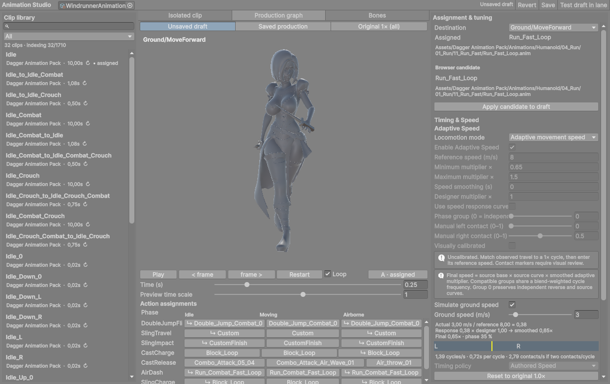
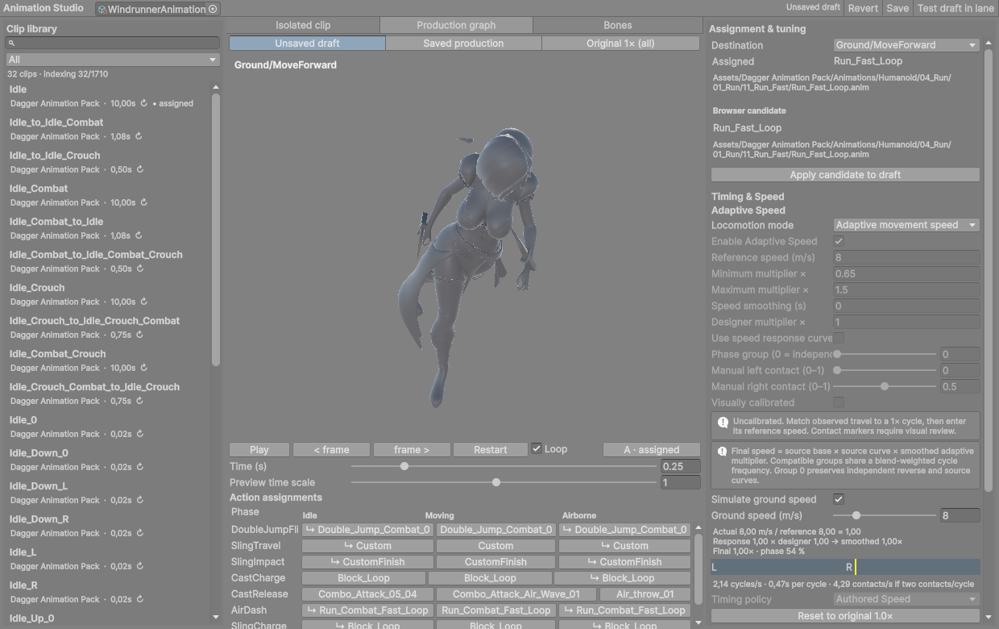
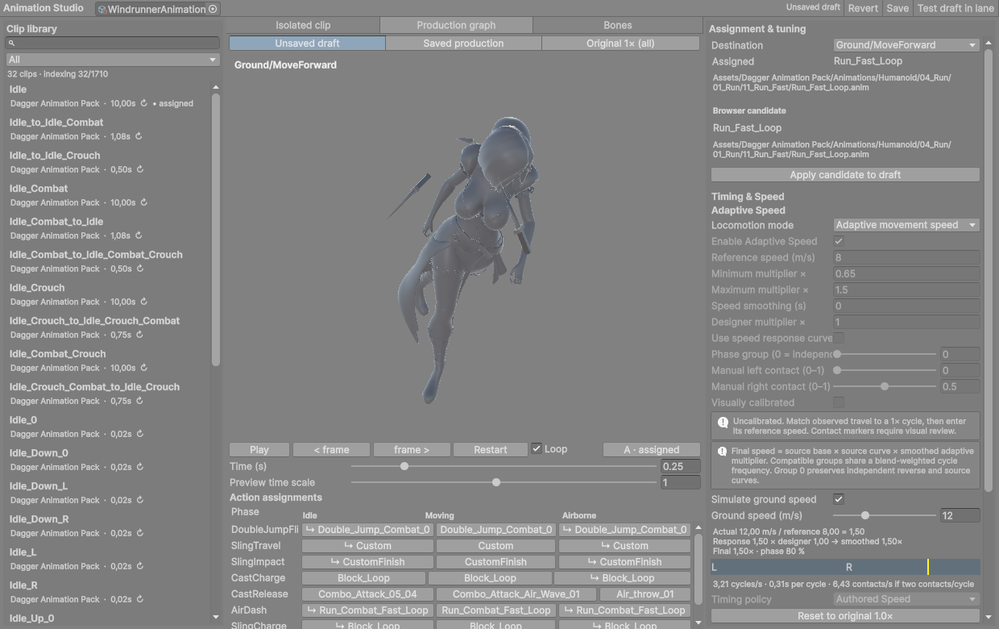

# Adaptive locomotion authoring

Implemented from local checkpoint `8e2e12bd` on `codex/dagger-pack-animation`. Adaptive timing is opt-in per directional walk/run assignment. Existing serialized profiles load with adaptive disabled. Designer calibration is staged in the existing detached Studio draft and saved through the existing module workflow.

## Timing audit

The installed fast forward, forward diagonal and side run loops last 0.466667 seconds. Backward and backward diagonal loops last 0.666667 seconds. Walk loops last 1.05 seconds. The previous shared gait clock uses normalized simulation speed, a 0.55–1.25 multiplier, the forward reference length, and optional walk/run frequency blending. At full run, the installed fast forward loop samples at 1.25× and the longer backward loop at 1.785715×. Walk timings recorded at full-run input describe samples whose blend weight can be zero. The [assignment audit](AnimationTimingAudit.csv) contains source paths, lengths and the existing timing measurements.

Starts, stops, pivots, turns and landing retain their visual state durations and their previously available explicit timing overrides. Start fitting currently gives 3.787879× and the forward stop 5.769232×. Selecting adaptive walk/run timing affects the movement loops. The existing controller still selects Idle, Starting, Moving, Stopping, Pivoting, Turning and airborne states. The profile currently suppresses reversal pivots and disables optional turning, so directional locomotion handles those changes.

The production bridge previously supplied motor simulation velocity. A blocked CharacterController can retain that velocity while its actual displacement approaches zero. The displacement authority now observes the position difference around each existing synchronous Move call and accumulates the resolved displacement for that frame. The bridge divides this observation by the actual scaled frame delta after motor, Sling and swimming have completed. This excludes direct teleports outside those movement calls. When a profile enables adaptive locomotion, grounded visual state selection and direction use the resolved velocity. Action context selection keeps its established input. Adaptive cadence receives unscaled metres per second independently of the visual normalized-speed multiplier.

## Speed calculation and phase

For each opted-in assignment the production graph calculates the following values.

1. Movement ratio equals actual horizontal metres per second divided by calibrated reference metres per second.
2. The optional response curve maps that movement ratio to a multiplier. Its horizontal axis is movement ratio. The existing source-progress curve has its own horizontal axis of normalized clip progress.
3. The designer multiplier scales the response. Minimum and maximum multipliers clamp that result. These limits bound the adaptive factor; source base speed and source-progress curves remain explicit contributions outside that clamp.
4. Exponential smoothing uses `1 - exp(-dt / smoothingSeconds)`. Zero smoothing applies the target immediately. New clocks begin at their minimum multiplier.
5. The resulting multiplier advances the existing source-time clock. Source base speed and the existing source-progress curve each apply once. Reverse follows the existing source sampler.

For example, at 6 m/s with reference 8 m/s, base 1×, designer 1×, zero smoothing and no curves, the result is 0.75×. At 12 m/s with the same settings it is 1.5×. The default minimum 0.65× limits slow cycles during the movement envelope. Idle and stop selection handle nearly stationary movement. These defaults are authoring starting values and remain marked uncalibrated.

Adaptive settings require AuthoredSpeed timing. A configuration combining adaptive with duration fitting fails validation with a visible Studio message. Original 1× bypasses adaptive, fitting, reverse, holds and speed curves on temporary profiles. Fixed designer speed uses the existing explicit source timing. Action timing, animation ownership and source-time diagnostics use the existing graph.

Phase group 0 uses independent source clocks and supports reverse, source-progress curves and holds. Groups 1–8 are explicit compatibility choices. For a group, the graph calculates each member's requested cycles/second using its own source duration and calibration, then averages active contributions using their actual mixer weights. Every member samples the same accumulated normalized phase. Direction changes update weights while retaining phase. Group phase pauses outside Moving and resumes after stops or landing.

The shared frequency is bounded by the intersection of all member cadence limits. This can constrain a member away from its independently requested speed. An empty intersection produces a configuration error. The readout exposes both requested adaptive multiplier and actual final source speed. Use separate groups for walk and run until their contact patterns and cadence limits have been visually matched. The 0.466667-second fast loops, 0.666667-second backward loops and 1.05-second walk loops have different source periods. Matching filenames or a shared pack does not establish compatible foot contacts.

Synchronized groups support forward cycles with constant source-speed settings. Reverse, source-progress curves and entry holds require group 0. Movement-response curves remain supported in groups. Manual left-contact progress anchors each member to the group phase. The right-contact marker is a visual calibration annotation. The phase strip displays both markers and the current source position. Neither marker emits gameplay events. These markers have no automatically inferred foot-contact accuracy.

## Calibration workflow

1. Open **Tools → Windrunner → Animation Authoring Studio V2**. Select a directional run or walk destination. Scroll to **Timing & Speed → Adaptive Speed**.
2. Select **Original 1×** and inspect a complete cycle using Play, frame steps and the isolated/composed views. Source seconds, phase, cycle frequency and loop duration describe the sampled clip.
3. Select **Adaptive movement speed**. Set **Reference speed (m/s)** to the observed travel speed that visually matches the clip at 1×. The initial 6 m/s is a starting value. Clip duration alone cannot establish natural travel speed for these in-place animations.
4. Enable **Simulate ground speed** and change the 0–40 m/s slider during playback. It feeds the production runtime calculation. Speed changes continue from the current preview phase. Restart reconstructs the preview at the selected constant speed. The composed view includes the existing idle/start/stop transitions.
5. Tune minimum/maximum multipliers, smoothing and designer multiplier. The default 0.08-second smoothing is a time constant, reaching approximately 95% of a constant target in 0.24 seconds. Reduce it when cadence visibly lags responsive movement.
6. Optionally enable the movement-response curve. Inspect the displayed actual/reference ratio, curve response, designer multiplier, smoothed multiplier and final speed. Existing base speed, source-progress curves and reverse remain below in Timing & Speed.
7. Frame-step a 1× cycle and set the manual left/right contact positions. Review the yellow source cursor against the L/R phase strip. Mark **Visually calibrated** only after reviewing contact and travel together.
8. Assign the same phase group only to cycles whose left/right contact ordering matches. Start with matching forward/strafe fast-run cycles. Review backward cycles and walk/run transitions before sharing their group. Invalid clamp intersections or unsupported source timing produce an explicit error.
9. Compare **Unsaved draft**, **Saved production** and **Original 1× (all)**. The editing controls keep the draft settings while the runtime readout follows the selected comparison. **Test draft in lane** uses the production player with temporary profiles. Stop Play to return to the retained draft. **Save** persists calibration and **Revert** restores the saved modules.
10. In the lane press **Insert**, then **Shift+Insert** for detailed diagnostics. The overlay reports the actual dominant locomotion clip, movement speed/reference, adaptive and designer multipliers, final source speed and phase. Action diagnostics retain their own timing. Expanded text refreshes at 10 Hz.

## Rendered Studio comparisons

The disposable test profile uses reference 8 m/s, base 1×, designer 1×, no curves, zero smoothing and 0.65–1.5 multiplier limits. At 3 m/s the minimum gives 0.65×, at 8 m/s the result is 1×, and at 12 m/s it is 1.5×. Captures use the same 0.25-second preview time. The loop duration readout reflects current cadence. The traversal estimate assumes the current adaptive multiplier stays constant.

## Manual acceptance

- Compare original/fixed/adaptive cycles at constant speed, acceleration, braking and very high traversal speeds.
- Hold movement against a wall, then strafe along it and move away. Confirm the visible gait follows actual travel and returns to Idle at rest.
- Review all eight directions, diagonal blends, rapid reversals, pivots and stationary turning under the enabled production states. Review both dagger pairs.
- Jump, land into running, stop abruptly, pause and resume. Check phase continuity, foot sliding and contact ordering through blends.
- Cast while stationary, moving and airborne, then exercise Dash, Sling and Second Wind. Review upper/lower-body transitions while adjusting only locomotion cadence.
- Save a calibrated draft, reopen the Studio and verify the settings. Play the saved profile and compare it with Original 1×.

Rendered stills and deterministic phase checks support implementation verification. Foot sliding and the natural reference speed for each authored clip require moving visual review.

## Verification evidence

Unity 6000.6.2f1 executed the following checks. All XML/log/report paths are under Logs/ProductionMigration.

| Check | Executed result | Evidence |
| --- | --- | --- |
| Full rendered Edit Mode suite | 136/136 passed, zero skips | adaptive-candidate-EditMode.xml |
| Full rendered Play Mode suite | 54/54 passed, zero skips | adaptive-final-PlayMode.xml |
| Final targeted Play Mode rerun after diagnostic refinements | 3/3 passed | adaptive-candidate-PlayMode.xml |
| Disposable calibrated profile saved, then loaded in a separate Editor process | 1/1 in each process | adaptive-persist-write-EditMode.xml, adaptive-persist-read-EditMode.xml |
| Serialized source contracts | 67 checked, zero failures | adaptive-serialized-contracts.json |
| Windows Development build | Succeeded, zero errors, 24 warnings, 26.89 seconds | adaptive-candidate-build.json |
| Rendered Windows startup | Initialized and survived 15 seconds, zero matched errors | adaptive-candidate-rendered-player.json |

The Windows executable is `Builds/adaptive-candidate/Windrunner.exe`. Warning subjects match `playback-candidate-build.json`. They include mesh read/write and collision import flags, shader diagnostics, an existing FEEL asset script warning and existing obsolete object searches. The startup check covers process initialization and idle survival. Gameplay captures were rendered in Unity Editor.

Disposable fixtures exercised collision displacement and multiple ordered movement steps, blocked travel, all production action clocks through accelerating/zero/airborne motion, zero-speed idle recovery, all eight directions, shared phase and incompatible clamps, reverse/source curves, Original 1×, Studio parity, draft Revert, saved calibration and actual Editor restart. The real-input adaptive Cast test retained the established single projectile behavior across standing, moving and airborne contexts. The full suites include existing movement, Dash, Sling, persistence and lifecycle tests.

The source diff preserves all existing scene, prefab, authored profile, animation source, metadata and project-setting files. All 42 audited clip hashes and their 42 metadata hashes match the preceding checkpoint evidence. Two new script GUIDs are unique. The bridge's existing retirement audit hash was refreshed after verifying its serialized fields match 8e2e12bd exactly. The retirement list is identical.

Earlier failed attempts remain in Logs. The first collision test selected Unity Object's implicit-bool reflection overload; its constructor call now explicitly passes an object array. An added test local initially shadowed an existing settings variable and was renamed. The serialized gate initially rejected the changed bridge source hash until the reviewed retirement exemption was updated. These failures are resolved in the results above.
