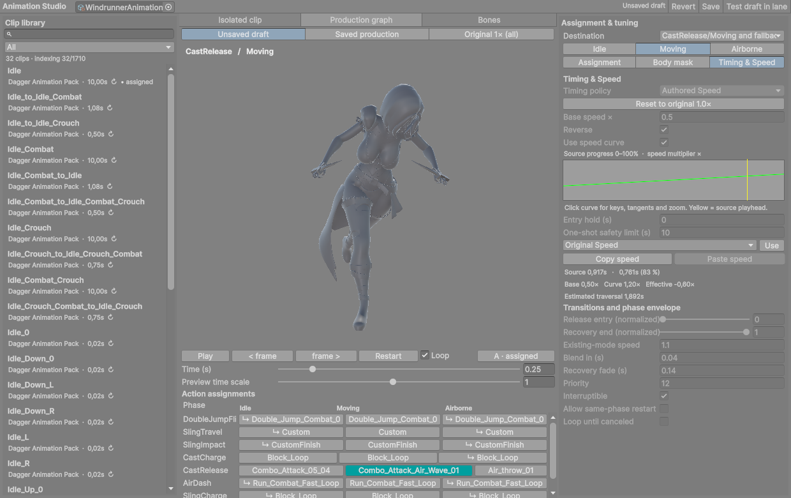
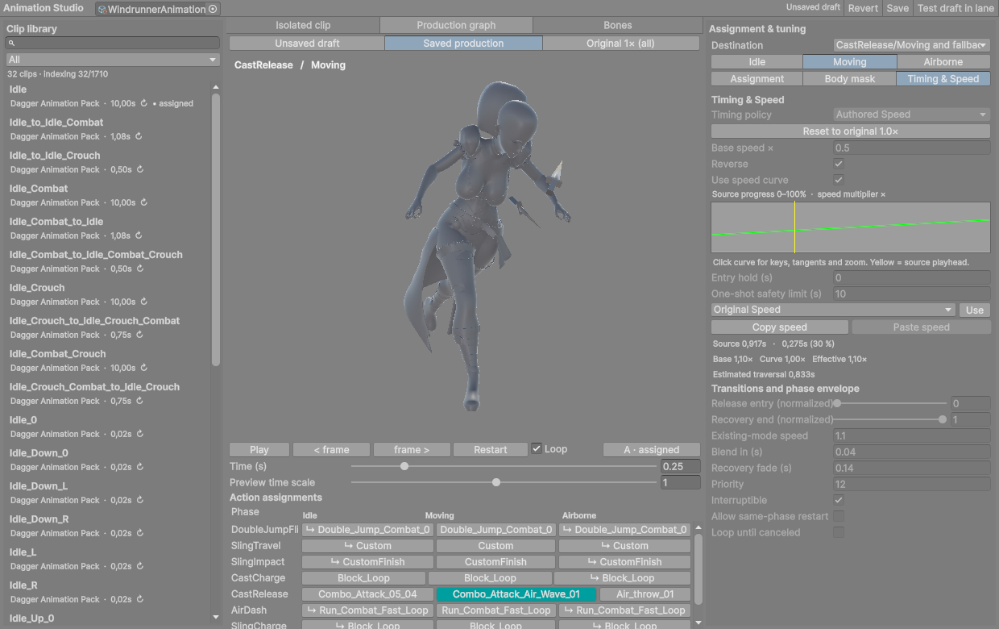
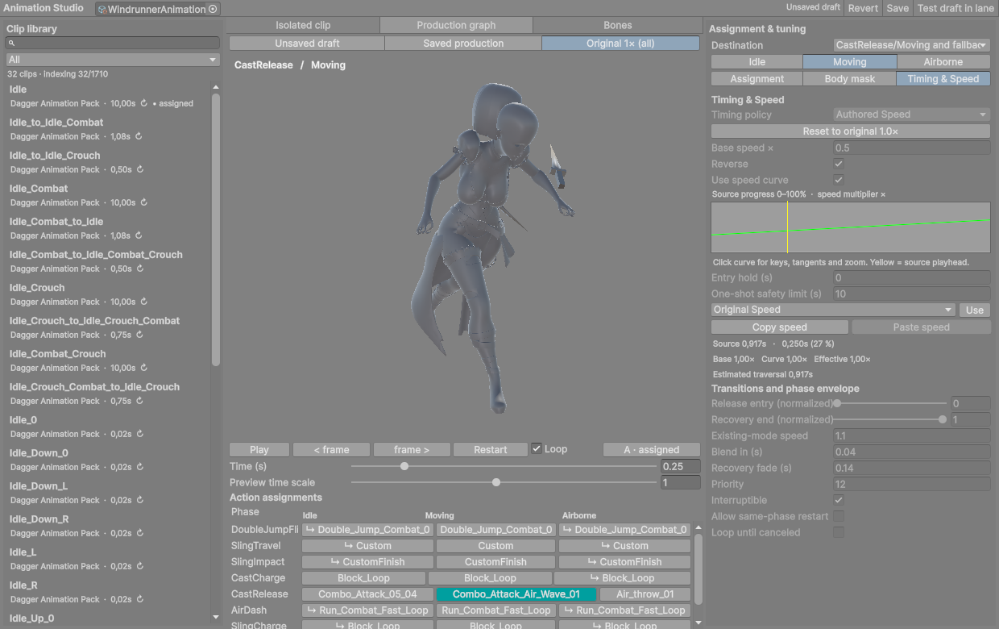

# Animation playback timing

## Audit baseline

Inspected clean `codex/dagger-pack-animation` at `2fa990e0`, which includes the artist's profile edits after `4674bfce`. Both profile assets remain the baseline for this implementation. The serialized-contract manifest still pinned their pre-2fa990e0 content. Its two fingerprints were updated after checking the committed author edits, all 44 referenced GUIDs across those profiles, and unchanged task-local asset content. The [per-assignment audit](AnimationTimingAudit.csv) records 33 ground slots and all three contexts of the eight configured action phases, measured against the installed clips. Directional rows use full-run input. Idle, one-shot and optional turn rows report their configured sampling policy even when that slot is inactive at that input.

The previously reported Standing_Throw_1 has source duration 2.166667 s, 30 Hz samples and a loop flag. The current stationary assignment is Combo_Attack_05_04, also 2.166667 s, with 60 Hz samples. Both are standalone .anim assets. Neither source requires repair. The duration compression comes from the action's visual clock. The source audit captured duration, loop/root flags and SHA256s for 42 referenced clips and their metadata in `Logs/ProductionMigration/playback-source-fingerprints.json`.

### Existing timing multipliers

- Action base speed is `PortableCharacterAction.playbackSpeed`. A context can select its own legacy speed through `overrideTiming` and `VisualTimingFields.Speed`. With neither context Speed nor Segment overridden, all contextual clips use the base action clip's duration as their normalized time reference.
- Effective contextual speed is **context source length / reference source length × selected speed**. The current CastRelease base clip is 0.916667 s at 1.1×, giving a 0.833333 s visual envelope. The 2.166667 s stationary clip therefore runs at 2.6×. The aerial clip runs at 1.1×. This envelope is a presentation choice. AirCaster owns the actual projectile release.
- DoubleJumpFlip runs at 1.35×. SecondWind runs at 2.4×. SlingTravel, SlingImpact, CastCharge, AirDash and SlingCharge run at 1× in their current base assignments. Ability cancellation still ends charge/traversal loops independently of clip speed.
- Ground idle uses `IdlePlaybackRate`, currently 0.85×. The shared rise/fall loop uses `AirborneLoopRate`, currently 1×.
- Ground movement uses **MovementPlaybackRate × lerp(0.55, 1.25, normalized motor speed)**, divided by the forward run clip length to produce shared cycles/second. With authored gait timing enabled, this frequency blends with the corresponding forward-walk frequency according to the gait mixture. Each directional sample multiplies that common phase by its own source length. Directional phase offsets change the sampled phase. The current fast forward clip lasts 0.466667 s. A 0.666667 s backward loop consequently plays at 1.785715× at full run, while the forward clip plays at 1.25×.
- One-shots fit source duration to the visual locomotion state's configured duration. Current starts fit 0.833333 s into 0.22 s, or 3.787879×. Forward stop fits 1.5 s into 0.26 s, or 5.769232×. JumpStart fits 0.416667 s into 0.15 s, or 2.777778×. Landing fits 1.333333 s into 0.28 s, or 4.761905×. Optional turn/pivot rows are listed in the CSV; the production profile suppresses those states.
- When `useAuthoredOneShotDurations` is enabled, the old policy uses clip length divided by `oneShotPlaybackSpeed`. The installed profile currently disables it.
- Clip Playables have speed zero and receive explicit SetTime samples. The graph evaluates with the frame delta once. Root motion cannot drive gameplay displacement. WindrunnerAnimationSession disables Animator animation events while the portable graph owns the pose, so reverse samples cannot deliver imported clip events. The preview time-scale control changes the audition wall clock only. Game time scale and pause affect supplied animation frame delta, and blend envelopes use that positive delta.

The timing extensions retain ExistingTiming for serialized profiles without assignment overrides. Selecting AuthoredSpeed replaces the existing slot's fitting/cadence factors. It makes base 1× with a flat 1× curve advance one source second per visual second. Independent directional clocks may alter foot synchronization between clips of different lengths. This is an artist-review tradeoff.

## Designer workflow

1. Open **Tools > Windrunner > Animation Authoring Studio V2**. Choose a ground destination or an action/context cell. Select **Timing & Speed** for an action. Locomotion destinations show the section below their assignment controls.
2. Choose **Customize this slot's speed** for an unconfigured locomotion slot. Enable **Customize context** for an independent Idle or Airborne action setting. Click **Reset to original 1.0×**. This writes a draft override with forward authored speed, a flat multiplier and no entry hold.
3. Set base speed to 0.5, 1 or 2, or enter another finite value from 0 through 100. Zero freezes source time. The one-shot safety limit defaults to 10 seconds and bounds held or very slow one-shot visual ownership. It is independently configurable up to 300 seconds. Gameplay-owned charge/traversal loops end through their normal cancellation signals.
4. Enable **Use speed curve** and click the curve to open Unity's keyframe/tangent editor. The horizontal domain is source progress 0–1, displayed as 0–100%. The vertical value multiplies base speed. Drag keys, edit their numeric values, select tangent modes or add/remove keys. The yellow line indicates sampled source progress. Presets and Copy/Paste operate on the selected draft assignment.
5. Enable **Reverse**. Playback starts at the configured segment end and reads the same source-progress curve from right to left. Scrub visual time, use frame-step controls and inspect source seconds and effective signed speed. Forward and reverse use the same source-time sampler with positive blend time.
6. Select **Unsaved draft**, **Saved production** or **Original 1× (all)** above the preview. Original mode temporarily neutralizes speed, curves, holds and fitting across the copied profiles, retaining source ranges, clips, masks and gameplay cancellation. Use both the composed graph and isolated clip views. The saved-production comparison uses the source module assets. The right-hand editing controls continue to show the draft in all three modes; its source-time readout follows the selected preview mode.
7. Click **Test draft in lane** to test the selected comparison mode on the production player. **Insert** shows animation diagnostics; **Shift+Insert** toggles expanded timing details. Use the Cast ledge and the established lane controls from [the Studio guide](AnimationStudioV2.md). Stop Play to restore the editing draft. **Revert** discards edits and **Save** explicitly persists them.

### Source ranges and recovery

Existing normalized source entry/end controls still select the action's clip segment. Forward starts at entry; reverse starts at end. Release entry aligns the visual pose sampled when gameplay has already delivered its release event. Independent speed lets a complete long throw finish at authored speed through nonblocking recovery. Higher-priority presentation and explicit cancellation still interrupt it. The maximum one-shot time is a visible safety cap.

**FixedVisualDuration** fits the selected segment to an explicit visual travel duration. Its diagnostics show the actual speed after fitting. This can match a known presentation window. Runtime gameplay events remain authoritative for activation and cancellation; the editor does not invent an ability phase duration or move a projectile event.

## Sampling and boundaries

`VisualPlaybackClock` integrates reciprocal speed over 1,024 source-domain intervals once per compiled assignment. Runtime samples the immutable table with binary search using elapsed visual time. Variable frame partitions and large steps reach the same table position. Curves use Unity's authored evaluation, including tangents, during compilation. Nonfinite values, unsupported ranges and negative curve samples fail validation. Curve lookup tables are built outside per-frame sampling. The developer timing overlay refreshes its additional formatted diagnostics at 10 Hz while expanded. Normal input edge displays retain their existing update behavior.

Source time, elapsed visual time, action/blend age and gameplay time have separate ownership. Context changes map normalized source position onto the new visual clock. Entering a zero-speed context retains the current source pose and can resume from that position in a subsequent context. Action age and blend time continue independently, including transitions back to the existing timing policy. They keep the same gameplay action and cannot emit a release. Blends continue in positive scaled time when source progression is reversed or held.

Whole-clip reverse and reverse looping are supported. Advanced signed curves are deferred. A continuous source-indexed speed field crossing zero creates an equilibrium, so a positive-to-negative crossing cannot reliably mean “reverse temporarily and continue.” Negative values are rejected. A zero multiplier is a hold barrier. **Hold and Release** uses an explicit finite entry hold followed by source progression. This keeps its release independent of a source clock that cannot advance while held.

All existing production ground slots and action/context assignments accept overrides. Optional unmapped bones and missing clips retain existing fallbacks. The current graph has no separately authored swim, dagger-melee or flourish action slot. Such clips remain browseable; this change adds timing authoring to available assignments.

## Manual acceptance

Compare original, saved and draft timing while idle, running and airborne. Review slow/reversed Cast wrist poses, both dagger grips and the recovery into running. Test takeoff, landing, charge cancellation, target loss, pause and interrupted Sling. Check independent gait settings for foot sliding when blending different-duration clips. Keep normal gameplay input active while slowing or reversing the visual action, and verify the single projectile/reward behavior. Artistic timing and foot contact require this visual pass.

## Rendered comparisons

The automated Studio probe samples the same moving Cast at 0.25 visual seconds in each mode. The draft uses 0.5× base speed, reverse and a 0.7–1.3× curve. Saved production uses the installed mapping and its existing timing. Original mode preserves the assignment and mask while sampling at 1×.

## Automated evidence

Unity 6000.6.2f1 executed **125/125 Edit Mode** cases and **51/51 Play Mode** cases with zero skips in `playback-final-EditMode.xml` and `playback-final-PlayMode.xml`. The deterministic cases cover constant 0.5/1/2 speed, variable curves, reverse endpoints and looping, segment boundaries, holds, finite hold/release, large steps, frame partitions, context re-anchoring, independent fades and an action deadline that survives mixed timing policies.

Real-rig comparisons sampled right-arm joints against a direct imported-clip Playable, including frozen reverse. They checked source timestamps, weighted pose influence and stationary root transforms. The Studio case used both isolated and production-composed modes for original, saved and draft timing. The existing real-input Cast scenario also ran with contextual reverse curves and still delivered one projectile. Mask and directional timing tests now use explicit fixtures or actual current clip durations, preserving the artist's different-length run clips and weighted pelvis settings.

The calling-thread allocation probe executed 10,000 compiled-clock samples and measured **0 managed bytes**. Construction, graph evaluation, rendering and the development overlay are outside that probe.

`playback-persist-write-EditMode.xml` saved a disposable profile with an airborne reverse curve at 0.7× and an independent 0.65× idle. `playback-persist-read-EditMode.xml` loaded and checked it in a separate Unity process. Both passed 1/1. All 42 audited animation sources and their 42 metadata files retained their SHA256 fingerprints. All 67 serialized source contracts pass, and the working diff contains no scene, prefab, imported animation, authored profile or project-setting changes.

Earlier failed compile/test attempts remain in Logs. The compilation corrections were test/editor wiring errors. The old locomotion assertion assumed all run loops had equal duration; the current author edits use different lengths. The native-mask fixture now explicitly selects native masks and measures convergence after a 0.25-second settling interval for the newly assigned stationary throw. Both final suites passed with these checks.

The rendered reverse-curve gameplay rerun passed **1/1** in `playback-rendered-PlayMode.xml`. Captures are `reverse-curve-stationary-throw-639305625059504691.png`, `reverse-curve-moving-throw-639305625060871598.png` and `reverse-curve-airborne-throw-639305625061764663.png` under Logs/ProductionMigration.

The **Windows Development build succeeded with zero errors and 24 warnings**, in 32.01 seconds, at `Builds/playback-candidate/Windrunner.exe`. Warning subjects match the earlier Studio V2 compilation build, including mesh import flags, shader diagnostics and three obsolete object searches in unchanged AirChimeTrial, PlayerWindFeedback and AutumnPostProcessController. `playback-candidate-build.json` records every warning.

The rendered Windows startup initialized and survived 15 seconds with no matched errors (`playback-candidate-rendered-player.json`). This checks startup only. Gameplay rendering evidence comes from the Unity Editor, and artistic acceptance remains manual.

See [Adaptive locomotion authoring](AdaptiveLocomotion.md) for optional movement-driven walk/run cadence, calibration, synchronized groups and production diagnostics.
