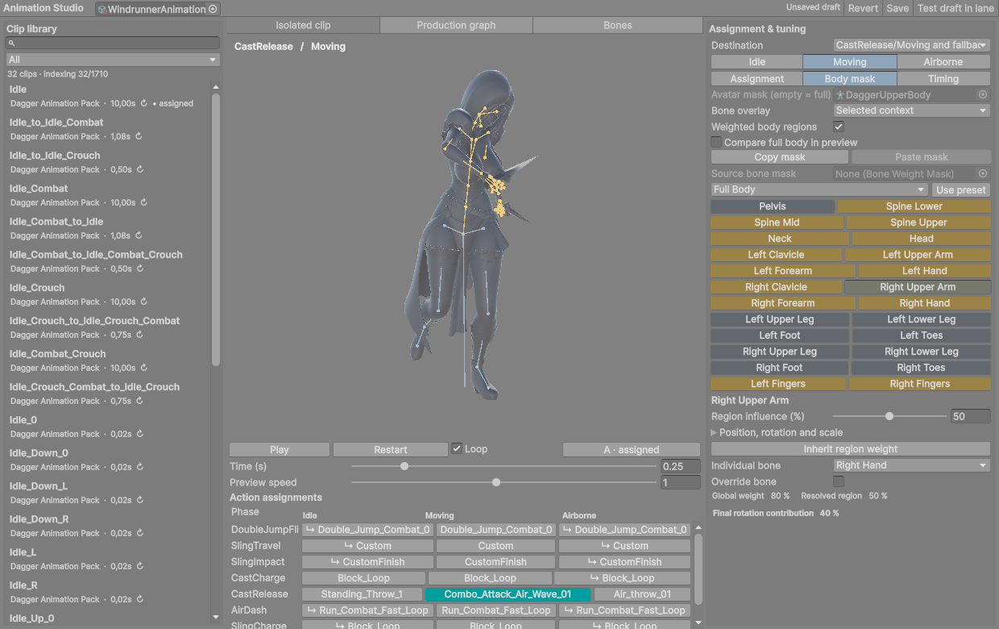

# Animation Authoring Studio V2

For per-slot speeds, curves, reverse and original/saved/draft comparison, use the [Timing & Speed guide](AnimationPlayback.md).

## Compare and edit on the production character

1. Open **Tools > Windrunner > Animation Authoring Studio V2** in Edit Mode. The toolbar shows the root character profile whose ground and action modules will receive explicit saves. The Studio can load the production Avatar and dagger mounts in a preview scene even from the title scene.
2. For locomotion, choose **Destination > Ground/Idle** or **Ground/MoveForward** (forward run). Walks, diagonals, starts, stops, jumps, landings, turns and pivots have separate destinations. For abilities, click a phase and column in the matrix. **Moving** is the base mapping. An arrow denotes a clip inherited from it. CastCharge and CastRelease are distinct rows.
3. Search the left panel by clip name or path. The index includes imported model subclips and standalone non-legacy Humanoid clips. Categories filter by name and path. Each row gives its pack, duration, loop and assignment status. Select a clip and switch **A · assigned / B · candidate**. Try **Isolated clip**, then **Production graph**. Drag to orbit, scroll to zoom, Shift-drag or middle-drag to pan. Pause and scrub for comparisons. Click **Apply candidate to draft** to keep the candidate in the draft.
4. For a moving throw, select **CastRelease × Moving > Body mask**. Enable **Weighted body regions**, choose **Right Arm** and click **Use preset**. Pause with the arm extended and drag **Right Upper Arm** between 0, 50 and 100%. **Bones** shows final rotation influence from grey to amber. Use **Compare full body in preview** to bypass this action's masks. For a stationary throw choose **Idle**, enable **Customize context**, and select **Inherit base clip**, **Inherit base mask** or independent overrides as appropriate. An empty native mask gives full body. An enabled custom mask can inherit the base and change just one region. **Copy mask** and **Paste mask** copy weighted settings between assignments.
5. Under **Timing**, set a source segment using normalized entry and recovery end. Set speed, blend durations, priority and interruption policy. A context can override individual timing fields. The release entry is the pose first sampled when gameplay releases the projectile. The recovery end caps the visual source segment. Preview speed only changes audition speed. Always check the transition from stationary to moving in the lane.
6. Click **Test draft in lane** and focus Game. **Insert** displays the evaluated context, action, clip, mask and time. **Shift+F5** sets up the Cast ledge. Cast while stationary, then strafe off the ledge and land. Repeat starting from a run and from the air. **F5** returns to the main deck for starts, stops, directional reversals, jump, Dash and Sling. Try both dagger pairs. For Second Wind use Farseer, F8 to supply rewards and F7 to spend main energy. Stop Play to resume the draft. Use **Revert** to discard staged changes or **Save** to write the owning module assets. A shared module affects every character profile that references it.

## Pose ownership and compatibility

At checkpoint 6cb9f475 the portable framework already had weighted pose composition. The montage code exposes `LiveActionMaskEvaluator` to `WorldLookAimRuntime`, with `RegionInfluenceSettings`, `BoneWeightMask` and `FlattenedPoseStack` for per-bone blending. The standalone graph selected by the production bridge used Unity layer mixers with full-body or binary Humanoid AvatarMasks. Changing the montage's region rules could therefore have no effect on the production dagger actions.

The production path is `AirflowPortableAnimationBridge → WindrunnerAnimationSession → GroundOnlyPipelineRuntime → Animator`. The standalone graph now reuses the same flattened animation job and body mapping when an assignment enables weighted regions. Consecutive custom layers share a job. Existing native layers keep their AvatarMasks and their order. Both feed one final output on the character. The preview creates this graph on a separate Avatar and disconnects its isolated clip output while the production graph is selected. No controller, clip import changes or scene migration are required.

The mask resolves a local bone override first, then a local region rule, then a selected source mask or inherited base. Native Humanoid body flags supply the default when no weighted source supplies a value. A preset writes local rules. **Spine Lower**, **Spine Mid** and **Spine Upper** correspond to the Avatar's Spine, Chest and UpperChest. Missing optional Humanoid bones have no joint to drive. Pelvis affects the local hips pose. The character root and mounted weapon transforms are excluded from weighted writes. Child joints and blades still follow their animated parents. Position and scale controls require corresponding motion in the retargeted clip.

The resolved rotation weight is the per-bone coefficient before the action envelope. The global weight scales the action. The final coefficient also includes the phase envelope, context crossfade and occlusion by later layers. For example, a 50% region and 80% global weight yield 40% at full envelope with no later overlay. This number describes local blend contribution, not degrees of joint motion. Native mask visualization describes Humanoid body flags. Arbitrary non-Humanoid Transform-path masking is outside this editor.

Grounding and measured horizontal speed select the visual context. The enter/leave thresholds provide hysteresis. Context transitions preserve normalized visual phase on one action clock. Requests, projectiles and resource transactions remain in gameplay. Missing contextual clips use the base mapping unless explicitly muted. A missing base reserves the action slot. An inherited clip may have different mask, weight or timing settings. The accepted production assignments retain their existing playback by default. The production profile suppresses turn-in-place and reversal-pivot clips; audition their source in isolated mode.

Draft lane data is stored temporarily in Library and tied to the source profile dependency hash. The lane owns detached profile copies for its lifetime. Restarting the Editor is appropriate after an explicit save. Unsaved lane snapshots are for the current Editor session only.

## Measured acceptance evidence

On the production Humanoid rig, the moving CastRelease test sampled all three right-upper-arm settings at the same frame. Against the 0% pose, the 50% setting rotated the local joint by **38.643°** and the 100% setting by **77.272°**. The opposite upper arm differed by **0.000°**. The Studio comparison used a second instance of the production rig, identical motion frames, and a 0.3° local rotation tolerance. Changing the Studio draft changed the preview pose while the source module remained untouched.

The stationary full-body throw's largest tested lower-leg or upper-leg difference from bare locomotion was **50.88°**. With the moving native upper-body mask it was **1.68°** at the test sample after the crossfade. The rendered gameplay test crossed idle, moving and airborne within a single release and observed exactly one projectile release. Local images in `Logs/ProductionMigration` are `context-stationary-throw-639305316824919732.png`, `context-moving-throw-639305316826280259.png` and `context-airborne-throw-639305316827162094.png`.

The restart test explicitly saved a disposable character module in one Unity process and loaded it in a second process. It checked the airborne clip, the 37% right-hand override and the other two context assignments. The lane test installed a detached 51% right-hand draft on the real player's bridge, observed the active portable graph, replaced the scene, and verified destruction of all three detached profile objects and restoration of the original binding. The routine Edit Mode run also covers Idle and forward-run A/B, staging and revert. See [migration progress](Progress.md#animation-authoring-studio-v2) for the final suite and build counts.

## Manual visual acceptance

Compare the hips, both wrists, finger curls and blade grips through the stationary throw, run and aerial release. Check the first and last frames of cropped segments at normal playback speed. Look for pops during takeoff, landing, interruption and return to locomotion. Review the same sequence with the skeleton hidden and both dagger pairs equipped. Pose measurements establish control and parity; artistic timing, foot contact and grip comfort require visual review.
