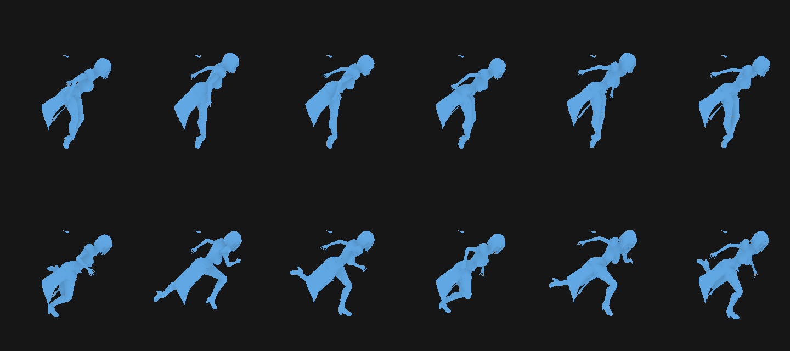
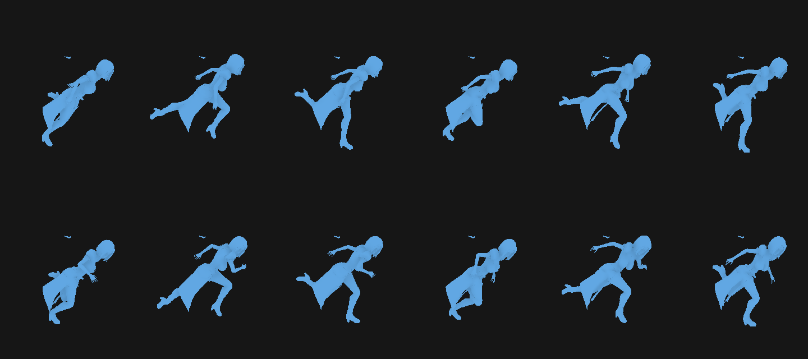

# High-speed leg composition correction

The manual acceptance failure was reproduced on the production Humanoid rig and authored action profiles. Work began at clean artist checkpoint `788c4400`, following `d56e0df1`. The artist's forward-run 1× override is preserved. Its adaptive setting and phase group are disabled.

## Confirmed cause

The authored CastRelease assignment enables custom weighted regions. This creates a transform-weighted `FlattenedPoseStack` in the portable graph even while Cast is inactive. AirDash previously followed that stack in a native `AnimationLayerMixerPlayable`. Activating this downstream Humanoid layer changed final leg rotations despite zero reported leg-mask weight. Removing the custom stage in a disposable comparison profile eliminated the discrepancy. Retaining transform-space composition after the first weighted stage eliminated the Dash-induced lower-body change while preserving the author's custom mask settings.

The `DaggerUpperBody` asset has the intended lower-body exclusion. At settled AirDash weight, effective hips, thighs, shins and feet contributions are 0. Spine, chest and arms receive 0.65. The correction applies those same AvatarMask-derived channel weights through the existing flattened stack after custom composition begins. Native muscle-space blending and local-transform blending can produce different upper-arm poses at the same weight. In the 15 m/s diagonal sample, left-arm excursion changes from 29.707° to 36.381° and right-arm excursion from 22.480° to 24.803°, while spine/chest excursion and the authored 0.65 coefficients are preserved. Upper-body appearance remains part of manual review. Native groups before the custom stage keep their native composition. There is one final Animator output. The graph's action clocks, priorities and gameplay cancellation paths continue to drive action lifetime.

This is a confirmed graph-boundary composition defect. The precise internal Unity reconstruction of Humanoid streams was not instrumented. Reported layer coefficients describe intended weights, so evaluated bone transforms are now also compared in the regression suite.

The corrected implementation is in `Assets/PortableAnimation/Runtime/Phase11/GroundOnlyPipelineRuntime.cs`. It retains custom region sources, inherited masks, per-bone overrides and source timing. Diagnostics continue to identify an authored AvatarMask as `DaggerUpperBody` even when its execution is routed through the transform-weighted stack.

## Controlled motion measurements

Each deterministic case runs 540 samples at 60 Hz, representing nine seconds. AirDash begins at one second. Joint measurements cover the subsequent seven seconds after settling. The matrix includes 7.5 and 15 m/s, forward, left diagonal and lateral travel, and additional 22.5°/67.5° blends in the corrected regression. Every case compares the production action graph, bare locomotion, and a disposable native-only profile. An additional authored graph with no action request is the masked-action parity oracle.

Motion values below are maximum angular displacement from the first measured local joint rotation. They are sufficient to expose the reproduced attenuation and are not a complete biomechanical range-of-motion measurement.

| 15 m/s case | Joint | Before | Corrected |
| --- | --- | --- | --- |
| Forward | Left thigh | 22.247° | 98.610° |
| Forward | Right thigh | 20.474° | 88.122° |
| Left diagonal | Left thigh | 31.287° | 89.159° |
| Left diagonal | Right thigh | 19.810° | 105.502° |
| Left lateral | Left thigh | 32.037° | 89.159° |
| Left lateral | Right thigh | 20.891° | 105.502° |

The corrected Dash layer differs by **0.000° at recorded precision** from the authored inactive-action graph across hips, thighs, shins and feet in all measured cases. The regression tolerance is 0.15°. Source time advances throughout the sustained sequence. Original source clips have substantial retargeted leg motion. The current profile has no adaptive phase group, and directional blending continues to animate through the sampled intermediate directions.

Bare native locomotion and the authored transform-weighted graph have different retargeted leg samples even with no action active. That existing difference appears in the CSV's `LocomotionDifferenceDegrees` column. The correction preserves the ordinary authored running composition. `AuthoredCompositionDifferenceDegrees` measures the unintended additional change caused by Dash and is the parity criterion.

The original character, clips, authored masks, speed override, source assets and imported metadata were preserved. The existing adaptive timing and original/fixed/reverse/source-curve regression suites remain part of validation.

[Full baseline measurements](HighSpeedLegBefore.csv) and [corrected measurements](HighSpeedLegAfter.csv) record hips, thighs, shins, feet, spine, chest and arms.

## Rendered comparison

Both sheets use the same rig, source assignments, 15 m/s left-diagonal input, camera and temporary unlit inspection material. The material makes the silhouette readable and exists only on disposable capture objects. Columns are successive samples at 1/15-second intervals, beginning at three seconds of the sustained run. The upper row is the authored graph with AirDash active. The lower row is the bare locomotion reference. Each complete measurement continues for nine seconds.

Before correction, the upper-row legs remain close to a rigid hanging pose.

After correction, the upper-row legs visibly cycle through flexion and extension.

## Dash lifetime and recovery

AirDash is a sustained gameplay state. `AirDashSession.WantsDash` accepts either held manual dash with movement intent or a reward-triggered auto-dash latch with movement intent. `EvaluateTick` spends AirPower and stops when the resource is exhausted. Releasing movement clears the reward latch. The production feedback adapter forwards DashStarted/DashStopped, and the animation profile starts/cancels the Dash group.

The new Play Mode case uses a disposable copy of the installed movement settings, actual input actions, motor, AirPower, AirDash, feedback adapter, animation bridge and production rig. It verifies four seconds of manual dash, recovery, three seconds of reward-latched dash, then movement release and recovery. It measured **15 m/s**, **96.688° right-thigh motion**, and approximately **60 AirPower remaining** after the manual segment. Both dash transitions started and stopped exactly once. Thus a sustained AirDash label is correct while those gameplay conditions hold.

The first fixture attempt used the generic test settings' 22-unit/second dash drain and exhausted the available reward-dash budget. The corrected fixture copies the installed 10-unit/second tuning. Gameplay tuning assets were untouched.

## Development comparison

1. Use **Tools → Windrunner → Acceptance → Play traversal and rewards lane** or the current production gameplay scene.
2. Select the production player in the Hierarchy. Locate its **Airflow Portable Animation Bridge** component.
3. During Play, open that component's context menu and choose **Development → Toggle locomotion-only pose**. This sets action pose weights to zero while action clocks, targeting, Dash state and movement continue.
4. Press **Insert** to display the recording overlay. It explicitly labels the isolated locomotion view. **Shift+Insert** exposes the existing timing details.
5. Compare sustained manual/reward dash, forward, diagonal and lateral travel. Toggle again to restore the currently valid action pose at its current source time. Cancelling Dash during isolation still cancels the action. Ending the graph or Play session discards the isolation state.

The isolation control is available only in Editor/development execution. It changes presentation weights through the existing graph and writes no profile or scene assets.

## Remaining manual acceptance

Repeat the recorded high-speed run with the normal materials and camera. Verify continued leg cycling during manual and reward-latched Dash, ordinary movement at 7.5–9 m/s, diagonal/lateral motion, and the transition back to running. Compare the temporary isolation view while preserving the same movement. Review weighted Cast, Sling and Second Wind transitions and both dagger pairs. Natural foot contact, foot sliding and overall animation style still require visual acceptance.

## Validation

Unity 6000.6.2f1 executed the following checks. Evidence paths are under Logs/ProductionMigration.

| Check | Result | Evidence |
| --- | --- | --- |
| Full rendered Edit Mode suite | 137/137 passed, zero skips | stride-final-EditMode.xml |
| Full rendered Play Mode suite | 55/55 passed, zero skips | stride-final-PlayMode.xml |
| Final sustained pose, mask diagnostics, isolation/restoration and evidence export | 1/1 passed, 30 cases and 330 joint records | stride-final-evidence-EditMode.xml, stride-final-evidence.csv |
| Manual/reward Dash on the production rig and installed tuning | 1/1 passed, also included in full Play Mode | stride-dash-production-PlayMode.xml |
| Serialized source audit | 67 contracts, zero failures | stride-serialized-contracts.json |
| Windows Development build | Succeeded, zero errors, 24 warnings, 27.54 seconds | stride-candidate-build.json |
| Rendered Windows startup | Initialized and survived 15 seconds, zero matched errors | stride-candidate-rendered-player.json |

The executable is `Builds/stride-candidate/Windrunner.exe`. Warning subjects match the adaptive candidate, including existing mesh import/collision flags, shader diagnostics, FEEL content and obsolete object searches. The Windows observation checks startup and idle survival. Sustained pose/gameplay validation and rendered stride comparisons ran in Unity Editor.

The final focused run followed the full suites and covers the diagnostic label, isolation restoration and culture-independent CSV export refinements. Source clips, masks, profiles, scenes, prefabs and project settings have no task diff. The 42 audited animation sources and their 42 metadata files retain their hashes. The new test script GUID is unique.

The source audit's ground-profile pin was advanced to the verified artist commit 788c4400. The bridge source pin was refreshed after verifying identical serialized fields and retired-field lists. Two pre-existing tests now compare Revert/source preservation against the actual authored baseline instead of assuming the forward slot has no override. The before runs intentionally collected the faulty behavior; the final test explicitly fails on lower-body changes above 0.15° relative to the inactive-action authored composition.
