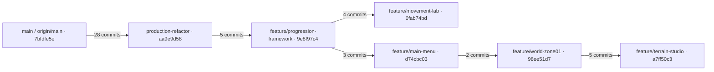

# Windrunner Production Integration Readiness Report

17 November 2026 · Unity 6000.6.2f1 · source baseline `a7ff50c3` · local Git refs

**Recommendation.** Start a disposable integration candidate from Terrain Studio. Fix the demonstrated Zone 01 save-routing defect before promoting that candidate. Bring in Movement Lab once as an isolated development target. A shared player-facing gym transition needs a separate ownership design. Human gameplay and visual acceptance remain open.

## History and integration boundary

Verified with local refs, merge bases, left/right commit counts, patch equivalence and tree diffs. The local branch named simply `progression-framework` is a stale alias at `aa9e9d58`. The six requested branches are local. The recorded remote-tracking refs point to the prototype baseline; this audit did not contact the remote.

The common ancestor of the two tips is `9e8f97c4`. Terrain Studio already contains all five main-menu/world commits as well as production, progression and its own five terrain commits. Its ten divergent commits are `49cd4689 272c450f d74cbc03 5bc01b71 98ee51d7 b9f822eb 61e389fd c24c719a 3ebcf329 a7ff50c3`. The four patch-distinct lab commits absent from that line are `9fe70b61 b0511e5e 7df1372c 0fab74bd`. No merge commit joins the two lines. Bringing the earlier linear branches in again creates unnecessary work.

### Conflict rehearsal and asset identity

The fork-to-tip diffs contain **158 paths on the terrain line and 46 on the lab line**. Their intersection is exactly four paths. Three-way comparisons used `git merge-file -p` on temporary copies of the three blobs. Each path had conflict markers. No branch, index or authored file was merged.

| Shared path | Required resolution |
| --- | --- |
| `Assets/AirflowPrototype/Editor/WindrunnerCandidateBuild.cs:32` | Retain the title → Zone 01 → legacy production scene list and the existing progression fixture. Add the gym-only scene selector and its Development build option and define from `0fab74bd:…/WindrunnerCandidateBuild.cs:35–46`. Preserve default build behavior. Reject ambiguous selectors even for direct command-line calls. |
| `Tools/Build-UnityCandidate.ps1:1,12` | Preserve the Editor guard, fresh-label check and evidence paths. Make MainMenu, MovementGym and ProgressionFixture mutually exclusive. Exercise each switch and an invalid pair. |
| `Documentation/Progress.md` | Preserve dated histories under their source checkpoints. Append the eventual integrated result after actually running its gates. |
| `Documentation/TestResults.json` | Both sides changed source hashes, runs, builds, smoke results and evidence hashes. Preserve branch provenance by label and revision, retain the terrain-only evidence, and reject same-label/different-hash collisions. Compute integrated source hashes from the new candidate. A line-level union of this JSON is unsafe. |

* No scene, prefab, ScriptableObject, input asset, asmdef, package or ProjectSettings path is in the divergent overlap. Neither side edited a prefab after the fork. The earlier three decorative source-prefab repairs in production are already common ancestry. The gym is an authored scene copy with its own references; identical script GUIDs do not imply identical serialized configuration.
* Compared 22 changed lab metadata entries against 9,967 distinct Assets GUIDs on the terrain tip. Zero cross-path collisions. Of 116 distinct external GUIDs serialized in MovementGym, 96 resolve to Assets in the prospective union, 18 to installed packages, and two are Unity built-ins. None of the pre-existing Assets references disappeared. This scan verifies file identity. Subasset/local fileIDs and prefab overrides still need a loaded Unity audit on the eventual candidate.
* Two direct gym scene dependencies changed on the opposite line: `WindrunnerInputHost.cs` and `AirSlingController.cs`. The latter now emits the Zone 01 defeat event. Keep both newer implementations. Changes to `PlayerMotor.cs` and `PlayerOrbitCamera.cs` after the fork are lab-only.
* Both tips have the same Packages tree `447bdbb2` and editor-version blob. Only the main-menu/world line changed `ProjectSettings/EditorBuildSettings.asset`. Enabled Editor scenes are MainMenu, StartingWorld, Batch1_Playground and World_Zone01. The explicit retail builder selects just the title and two worlds. The gym uses its own explicit build selector; adding it to retail build settings is unnecessary.
* The settings asset designates `Assets/InputSystem_Actions.inputactions` as the project-wide Input System asset. Scene input hosts instead bind the production or gym template explicitly. The gym asset retains every shared action ID and all 43 production binding IDs across Gameplay, System and UI, and adds 15 actions. Preserve both templates and their distinct .meta files. The two lab assemblies (`MovementLab.Rules`, Editor-only `MovementLab.EditorTests`) and three terrain assemblies have distinct names. The gym adapters compile with Assembly-CSharp and the gym Play Mode fixture joins the existing production test assembly. Compile and discover both test assemblies in the combined tree.

## Cross-system findings

| Severity / status | Evidence and effect | Proposed resolution |
| --- | --- | --- |
| **High · reproduced · release blocker** | `Assets/WindrunnerFrontend/SessionMenu.cs:114,139` calls `PlaythroughSlots.Create` without a world for copy and overwrite. Its default at `Assets/WindrunnerProduction/Progression/Runtime/PlaythroughSlots.cs:85` is starting-world. The actual pause UI wrote starting-world for **both** operations on a Zone 01 session. Loading the copy opened StartingWorld, with the copied fact still present. `PlayerSession.cs:88` routes by world. The legacy production catalog has no quests, so a valid file can strand progress behind the wrong catalog. A confirmed replacement also initializes the backup from the replacement body (`PlaythroughSlots.cs:140`). | Put copy/replace behind the current PlayerSession; carry its canonical world and arrival explicitly, including direct-in-Editor sessions with no bound slot. Verify Zone→Zone, legacy→legacy, overwrite of a different world, and subsequent Continue. Preserve the existing envelope, lock and revision checks. |
| **Important · reproduced with both real templates** | `WindrunnerInputHost.cs:62` uses the default namespace. `WindrunnerInputService.cs:34–40,56–60,243–246` loads and rewrites one whole override document. The probe bound gym LabReset to K, saved a production Jump override, and reopened the gym template. LabReset had lost K and returned to F12. The clone shares common IDs but production cannot serialize a gym-only binding. This affects users of both configurations in the same preferences domain. | Separate overrides for lab-only bindings, or use the existing per-template preference-prefix facility for an isolated dev host. If common sensitivity and standard bindings are intended to follow the player, preserve them deliberately. Preserve the production key and users’ existing overrides. Test template round trips, conflict rejection, reset and reconnect. |
| **High if scenes are connected · confirmed ownership mismatch** | The gym has one root with `persistAcrossScenes: 1` and its own action asset (`0fab74bd:Assets/MovementLab/MovementGym.unity:36924,36953`). Title, legacy and Zone 01 set persistence to 0 (scene lines 373, 56133 and 15686 respectively). `ProjectRoot.cs:29,42` destroys an incoming duplicate; `WindrunnerInputHost.cs:47,92` only rebinds its UI. `PlayerSession.cs:47–51,60` expects its serialized scene host and live runtime. A surviving gym root cannot satisfy this contract. There is currently no production menu route to the gym. | Integrate the lab as separately launched development content. If seamless travel is later required, test explicit teardown/transfer and exactly one root, service registry, input host, event system, camera and listener in each direction, including inspection flight. Do not solve this by placing another persistent root in a world. |
| **Medium · confirmed catalog-selection defect** | `SessionMenu.cs:228–235` gets unlock state from the selected slot but enumerates cinematics from the current scene’s catalog. Opening legacy details on the title can list Zone 01 milestones; opening Zone 01 details in the legacy world can show an empty gallery. Title’s `MainMenu.unity:339–342` binds different legacy and current catalogs. `ProductionCatalog.asset:15` has empty definitions; `Zone01Catalog.asset:120–128` defines two milestones with Timeline content and no gallery replay videos. | Resolve the selected record’s world through the same catalog resolver used for loading. Add cross-world gallery tests. Keep unavailable video replay disabled; the catalog-selection fix requires no new art. |
| **Conditional · standalone progression import** | `SessionMenu.cs:107–109` imports progression.json via NewGame, which always creates Zone 01 (`PlayerSession.cs:103–111`). `ProgressionService.cs:33–46` reconciles installed quests and retains unrecognized records. Structural acceptance alone does not establish that old content maps to the Zone 01 chapters. | Use known legacy payload fixtures before claiming semantic migration. Preserve unknown records and source files. Where no mapping is known, surface the ambiguity instead of rewriting world IDs. |

### Boundaries that can be preserved

* **Player, animation and tuning.** The gym, Zone 01 and legacy scene each serialize one motor and one portable bridge. The shared animation profile sets productionOnly at `Assets/WindrunnerProduction/Animation/Generated/WindrunnerAnimationProfile.asset:16`. Character Tuning builds drafts and allowlists live-preview profiles at `CharacterTuningSession.cs:82–90,180,229`. Lab tuning has a separate profile and editor. Its motor hook runs after BeginFrame and before the single locomotion displacement (`0fab74bd:Assets/AirflowPrototype/Runtime/PlayerMotor.cs:252–260`). Overdrive spends existing AirPower, is controlled by the lab equipment flag, and requires lab actions (`MovementLabPlayer.cs:53–65,109–112`). It is neither a saved progression unlock nor a ready-made Zone 01 component. Copying the whole component into Zone 01 would also run its station lookup and startup teleport. Keep production influence unassigned and the graph owner intact.
* **Progression and world startup.** The title has one PlayerSession and no ProgressionHost. Each production world has one of each. PlayerSession runs at −8500, registers the selected service, and uses memory for a direct scene launch (`PlayerSession.cs:12,44–61`). ProgressionHost runs at −8000, reuses the registry service, checks player/catalog identity and only falls back to a file store if absent (`ProgressionHost.cs:9,23–32`). The gym has no authored PlayerSession or ProgressionHost. Zone hunt credit comes from the lethal Sling event (`AirSlingController.cs:717`, `EnemyProgressionAdapter.cs:20–34`), so wind or a teleport must not synthesize rewards. Keep quest, objective, character, chapter and Timeline IDs stable.
* **Settings and terrain.** The menu delegates rebind/sensitivity to input and keeps desktop/mixer preferences under a different prefix (`SessionMenu.cs:198–221`, `DesktopPreferences.cs:37–47`). Terrain Studio adds authoring objects only on explicit attachment. `StudioSetup.cs:44,61–67,78` binds Terrain and collider to the working copy and keeps spline authoring Editor-only. Zone 01 currently has no StudioTile binding. Preserve the original basin and the accepted reference repairs; test painting, spline edits, Undo and packaging on disposable copies.

## Terrain Studio memory investigation

**Finding.** The earlier ~28 MiB figure measured growth in Unity-wide used memory during early edits with Undo enabled. The larger run shows two distinct costs: substantial managed allocation each edit, and roughly 516 MiB held by Undo at steady state. The observed footprint levels off during this workload. There is a smaller residual after closing each scene; its owner and eventual limit were not established.

On Windows, in one fresh headless Editor, four consecutive disposable scenes each cloned the 2,048 × 2,048 m Zone 01 TerrainData (1,025² height, 512² paint). Each contained 16 crossing carriage roads sampled along roughly 19.5 km. Every six-step sequence performed a height edit with an actual debounced automatic repaint, a road relocation and bake, road generation/deletion with bakes, a native paint/capture/release with bakes, a rebuild with Undo/Redo, and another local rebuild. Each cycle ran 20 sequences. **480 operation steps, 80 of each kind, 147.27 seconds**. An independent 96-step pilot also completed. Workload counts include multi-bake operations. All save and deletion operations targeted unique disposable assets. The final source dependency hash matched its initial value.

Values in MiB. “Unity used” is the engine-wide allocated-memory counter. “Mono used” is managed heap usage. “Terrain + meshes” sums Unity's runtime object-memory estimates for all loaded TerrainData and Mesh objects, a subset of native-backed objects. Per-column peaks are sampled maxima and can occur at different steps. Counters overlap and must not be added.

| Checkpoint | Unity used | Mono used | Terrain + meshes | Unity reserved | Windows private | Working set |
| --- | ---: | ---: | ---: | ---: | ---: | ---: |
| Baseline, source loaded | 484.1 | 43.5 | 2.2 | 1,368.0 | 1,502.4 | 1,327.4 |
| First working tile, setup Undo cleared | 499.3 | 52.2 | 9.9 | 1,374.0 | 1,550.6 | 1,377.4 |
| Highest sampled during 480 steps | 1,025.8 | 89.2 | 15.5 | 1,888.1 | 2,086.9 | 2,001.4 |
| Last cycle after forced GC, Undo intact | 1,025.8 | 59.4 | 15.5 | 1,888.0 | 2,048.6 | 1,995.8 |
| Same tile after clearing disposable Undo and GC | 509.5 | 59.4 | 15.5 | 1,888.0 | 2,048.7 | 1,995.8 |
| After fourth scene close, fixture deletion, unload and GC | 496.3 | 49.6 | 2.2 | 1,888.0 | 1,487.9 | 1,452.6 |

* **Allocation rate.** A 4 MiB positive control verified the whole-Editor “GC Allocated In Frame” recorder each cycle. Median peak-frame allocations per operation type were 23.39, 25.07, 46.89, 46.79, 23.42 and 23.42 MiB in the order above. These include Editor/test-runner work; multi-frame peaks do not measure total bytes allocated over the whole operation. They do not measure retention.
* **Retention.** In cycle four Unity used 997.1 MiB at step 12, 1,025.1 at step 24 and 1,025.8 at step 120. Clearing Undo released about 516.3 MiB in each cycle while the tile stayed loaded and managed heap use barely changed. This intervention implicates Undo history. Complete snapshots are requested for the paint state (`StudioUpdates.cs:146`), TerrainData and alphamap textures (`TerrainPainter.cs:161–162`), and the mesh (`WheelRibbons.cs:63`). The measurements do not apportion retained bytes among those objects.
* **After closure.** Unity used 493.2, 495.2, 495.7 and 496.3 MiB after successive cleanups. TerrainData/Mesh counts returned from 2/4 to their initial 1/3 every time. Unity kept a reserved pool about 520 MiB above initial size. Final private bytes were below initial; the resident working set remained about 125 MiB higher. The remaining +12.2 MiB Unity used and +6.1 MiB managed relative to startup include Editor imports, logging, caches and the harness. Attribution needs snapshots. This run provides no evidence of 28 MiB leaking per edit or a universal Undo cap.
* **Disposition.** Preserve Undo semantics. Do not clear designers’ Undo history or redesign terrain storage on this evidence. If interactive pauses or multi-tile working sets exceed a real authoring budget, profile a multi-hour rendered session, compare Memory Profiler snapshots after matched cleanups, and isolate texture, state and mesh snapshots one at a time on copies. Raw checkpoints and all 480 frame observations are in [IntegrationRetentionSamples.csv](IntegrationRetentionSamples.csv).

## Integration implementation plan

| Stage | Work and required verification before advancing |
| --- | --- |
| **1. Establish the candidate** | Branch from pinned `a7ff50c3` in a separate worktree. Record paths, blob IDs, serialized references, build settings and historical results. Keep each incoming Unity GUID with its asset. Make copies of representative save fixtures in unique sandbox directories, including old-world, Zone, standalone progression, corrupt-primary/valid-backup, both copies invalid and future-version records. No real save folder or regenerated scene is needed. |
| **2. Fix world identity before adding the lab** | Add the failing menu-path assertions to the regular suite. Correct copy/overwrite routing; choose the gallery catalog by selected world. Exercise new game, direct-play copy, current save, independent copy, confirmed overwrite, cancel, Continue, legacy loads, pending cinematics and wrong-world records. Verify both stored metadata **and the scene actually loaded**, quest availability, and original slot preservation. Keep genuine legacy slots readable. An already mistagged slot cannot always be classified from its payload. Build a read-only scanner for world-exclusive quest/milestone IDs if affected saves are found; offer an explicit backed-up repair only for unambiguous cases. Two empty records can be indistinguishable. No blanket conversion. |
| **3. Integrate the four lab commits together** | Use the candidate as the destination and `0fab74bd` as the single incoming tip. Manually reconcile the four shared paths as above. Keep the gym input template, profile, scenes and asmdefs under their own paths. Keep release build settings and authored scene YAML byte-identical unless a separately reviewed fix explicitly requires an edit. Validate input preference isolation before advertising rebinding support for both configurations. Do not add the gym to persistent playthrough routes. |
| **4. Verify the Unity union** | Compile Editor and player assemblies on 6000.6.2f1. Audit loaded prefab/scene references including local fileIDs, scripts, Timeline bindings, profile types, duplicate roots, listeners, input maps and effective overrides. Run `Tools/verify_serialized_contracts.py`, CharacterCompositionAudit, ProgressionSceneValidation, Zone 01’s validate-open-zone command and Validate Terrain Setup on disposable authoring copies. Use existing validators before writing a converter. No scene/prefab migration or asmdef rewrite is indicated by the branch diff. |
| **5. Exercise system boundaries** | Full Edit and Play suites, plus filtered profiling/rendered cases. Compare production motor traces with influence absent; then gym wind entry/exit, Overdrive spend/depletion, Sling interruption, station reset and flight restoration of player/camera/listener. Verify portable takeover, action fallback, tuning preview/discard and identical source profile hashes. Test focus loss, reconnect, pause/hit-stop and rebinding in each template. Test title→Zone→title→legacy and single service ownership, lethal Sling credit exactly once, timed delivery, watched/skipped Timeline recovery and progress after reload. Test terrain/collider identity, protected paint, wheel-only rendering and undo/reopen after a disposable bake. |
| **6. Package and accept** | Build the explicit three-scene production Windows target, separate gym Development target, progression fixture and disposable painted preview. Inspect scene manifests, gym-only defines, packed terrain/mesh and stripped authoring history. Smoke each executable; compare warning origins with each target’s own baseline. Require zero errors and no unexplained new warnings. Capture new integrated hashes/counters; keep old evidence under its originating tip. Retire the candidate or revert its scoped commits if any gate fails. Promote only after acceptance. |

**Manual gates for the eventual unified build**

1. Play the prototype-equivalent production route with keyboard/mouse and gamepad. Check steering, jump, Dash, Sling, Cast, swim, camera, animation, FEEL and localized waterfall audio.
2. On named test slots, complete the basin hunt and timed delivery. Watch/skip the milestones, copy and overwrite disposable slots, quit and Continue. Confirm the right world, dialogue and journal. Open an old-world slot and check its catalog.
3. Launch the gym development build independently. Compare dry, continuous and impulse tracks; drain and refill Overdrive; enter/leave inspection flight. Verify controller, camera, sound listener, pause, and chosen controls recover.
4. On a disposable terrain scene, sculpt a ridge, move a road across a tile seam, protect a painted mark, Undo/Redo and reopen. Inspect wheel wear, frame responsiveness and traversal feel. Run the Character Tuning preview/discard sequence and check the authored profile diff.

## Evidence and reproduction

| Newly executed audit | Result |
| --- | --- |
| Serialized source-contract audit against `7bfdfe5e` | Zero failures |
| Existing real menu new/save/continue/world-transition control | 1/1 passed |
| Disposable Zone slot routing, Play Mode | 0/1 passed. Both writes mistagged; actual load opened StartingWorld |
| Disposable gym→production→gym binding persistence, Play Mode | 0/1 passed. LabReset returned to F12 after a production Jump override write |
| Disposable memory pilot and extended run, Edit Mode | 1/1 passed each |
| Combined branch compilation, suites, builds, human acceptance | Pending an authorized integration candidate |

The input probe exercised the shipping service’s save routine with actual templates and an isolated PlayerPrefs prefix. The slot probe drove real UI buttons and scene loading with a unique temporary slot directory. Both negative checks assert the desired behavior. Their failures should turn green only after the scoped fixes. The normal control and the probes answer different questions.

The guarded runner wrote XML/logs under `Logs/ProductionMigration` with labels `integration-menu-control`, `integration-route-audit`, `integration-input-audit`, `integration-retention-01` and `integration-retention-long`. The long-run XML SHA-256 is `ddaa74fb18c2b9d511d75be72aa8ad0468f0ad1230d1ab0f89a1b1ff03c20d16`. The prior 75/75 Edit Mode and 35/35 Play Mode results, 21-warning production build and eight-warning painted build are historical Terrain Studio evidence. The gym’s own 32/32 Play Mode checkpoint predates integration. No unified player build was attempted.

To reproduce on a disposable checkout with the Editor closed, copy `Tools/TerrainRetentionProbe.cs.txt` into `Assets/WindrunnerTerrain/Tests/Editor/TerrainRetentionProbe.cs`, or `Tools/IntegrationSlotRouteProbe.cs.txt` into `Assets/WindrunnerProduction/Tests/PlayMode/IntegrationSlotRouteProbe.cs`. For the input check, export the UTF-8 JSON of `0fab74bd:Assets/MovementLab/MovementLabGameplay.inputactions` to `Logs/ProductionMigration/integration-gym-input.json`. Run `Tools/Run-UnityTests.ps1` with a fresh label and the filters `DisposableTerrainUndoRetention` (EditMode), `DisposableSlotRouteAudit` or `DisposableGymRebindRoundTrip` (PlayMode). Remove only the copied probes and their generated metadata after exit. The memory probe uses Windows process counters and clears Undo exclusively inside its fresh batch Editor.

**Next milestone:** a save-compatible candidate based on `a7ff50c3` that passes the Zone 01 save-copy/overwrite round trip before the Movement Lab merge.
