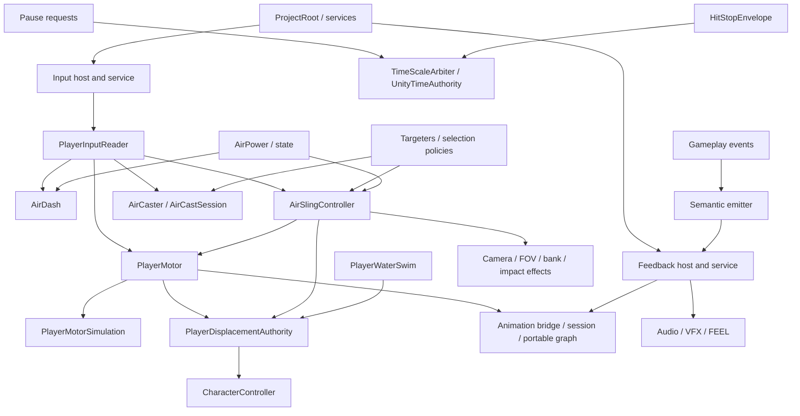

# Windrunner production architecture

## Current integrated candidate status

The latest implementation supersedes historical open-item descriptions below: portable action phases and compatible placeholders are integrated, remaining owner-scoped presentation camera paths are fixed, and representative traversal/lifecycle profiling executed twice. See AnimationWorkflow.md, ArchitectureReview.md and ReleaseCandidate.md for the current completion boundary. Automatic portable takeover and legacy retirement still require manual visual acceptance. Optional vendor template warnings and missing authored clips are noncritical debt, not missing core architecture.

## Baseline and scope

Audited 2026-11-12 at `7bfdfe5e`, branch `production-refactor`, initially clean. This is the user-confirmed 5P baseline (commit message `5J?`). No 5Q source labels or delivery documentation found. No tower-defense project/reference is available in this repository; reuse neutral lifecycle patterns without inventing its conventions. Unity 6000.6.2f1 (770e33f6875c) is installed. URP 17.6.0, Input System 1.20.0, Test Framework 1.8.0 are declared.

## Inventory and ownership

Latest continuation: see ArchitectureReview.md and Progress.md. Explicit reader/feedback binding, source-filtered animation, scoped core camera/reward resolution, Sling presentation separation, water/device-loss/target-loss coverage and persistent-service scene reload are implemented. Rendered native-allocation baselines and exact Windows warning classification are available. Historical inventory below remains useful; it does not supersede the latest stage records.

Current implementation includes continuation checkpoints `5f4f6645`, `617cb5e8`, `365d6aaf`, `fc550cfc`, `27fa589d` plus the final input-lifecycle/build checkpoint. Detailed boundaries: MovementAuthority.md, TimeOwnership.md, AbilityComposition.md. Historical failures remain in Progress.md and TestResults.json.

| Area | Installed implementation | Boundary / remaining work |
|---|---|---|
| Project lifetime | ProjectRoot, ProjectRuntime, ServiceRegistry, GameStateMachine | Explicit services exist; static Active hosts and distributed discovery remain. |
| Input/pause | WindrunnerInputService/Host, pause controller/view, PlayerInputReader, TimeScaleArbiter | Sling uses configured input; nested pause/hit-stop arbitrated. Global input host still assumes one local player. |
| Motor | PlayerMotorSimulation, JumpWindow, FlowState, PlanarSolver, PlayerDisplacementAuthority | Regular C# owns integration and velocity. One synchronous displacement boundary preserves motor/Sling/swimming order. |
| Sling | AirSlingController, FlowState, ChargeState, DashProgression, BezierPath | State/calculations extracted; orchestration, resource spend, physics and camera/presentation still coupled. |
| Targeting/cast/dash | AirTargetSelectionPolicy, AirSlingTargetScoreMath, AirCastReleasePolicy, AirCastSession, AirDashSession | Charging/execution rules extracted and tested; adapters still resolve scene dependencies. |
| Resources/rewards | AirPower/State, IAirPowerBudget, AbilityResourcePolicy, AirFlowHitSystem, AirSlingDeathReward | Explicit payment/depletion contract; real Cast return reward/Dash subscription order tested. |
| Animation | PortableAnimation, WindrunnerAnimationSession/Profile, AirflowPortableAnimationBridge | Portable graph ownership/rollback exists; legacy humanoid/custom/procedural writers remain and must be audited per scene. |
| Feedback | semantic emitter, FeedbackService/catalog/pools, FEEL backend | Playback gated by migrated-event flags; legacy effects still intentional. Animation actions consume feedback observations. |
| Camera/audio/UI | PlayerOrbitCamera, PlayerSpeedFeedback, AirAudioDirector, cast/hit/perfect feedback, charge/resource UI | Pause interaction tested; runtime UI owns material clone and typed resource reads. FOV/bank composition and service discovery remain distributed. |
| Scene tooling | Batch setup tools, 5B/5L/5O/5P migrations, ownership audit | Opt-in migration tools exist, not proof of every scene's migration state. |

`Assets/AirflowPrototype` contains runtime, editor installers, generated playground/settings, audio and character assets. `Assets/WindrunnerProduction` contains Runtime, Input, Animation, Feedback, Integrations and Editor assemblies. `Assets/PortableAnimation` is a separate reusable foundation. Other asset roots include FEEL, MagicaCloth2, Toony Colors Pro, animation/art/VFX packs and their demo scenes. These are not automatically obsolete. Only `Batch1_Playground.unity` is enabled in build settings; SampleScene is disabled.

The baseline inventory script counted 153 AirflowPrototype C# files, 26 production C# files before tests, and 74 PortableAnimation files. Vendor code includes 889 FEEL and 176 MagicaCloth2 files. Largest owned runtime adapters: PlayerHumanoidAnimatorDriver 1,463 lines, AirSlingController 1,245, PlayerMovementVisuals 1,183 and PlayerProceduralKnifeFlick 1,149. These sizes identify review candidates, not deletion criteria. The largest editor tools are AutumnSandboxGenerator (1,641), PlayerHumanoidAnimatorControllerBuilder (1,589) and AirSlingBatch18Setup (1,475). No duplicate GUIDs were found among Assets metadata. There are three prefabs under AirflowPrototype/WindrunnerProduction.

The serialized gameplay scene has enabled PlayerMotor, AirSlingController, PlayerWaterSwim, PlayerHumanoidAnimatorDriver, PlayerMovementVisuals and AirflowPortableAnimationBridge on `Airflow Player`. Runtime graph takeover must be observed before interpreting enabled flags as simultaneous pose writers. Full machine-readable source size, component inventory and serialized fingerprints are generated by `Tools/audit_project.py`; baseline evidence is in `Logs/ProductionMigration/baseline-inventory.json`.

Animation readiness is incomplete: the installed WindrunnerAnimationProfile has `automaticallyStartPortableInPlayMode: 0` and all five semantic action bindings have `montageSlot: -1`. The bridge therefore observes by default; installing the architecture did not replace the legacy Animator or integrate actions. PlayerMovementVisuals has its legacy procedural animation disabled in the gameplay scene. Do not delete the humanoid driver or claim production action animation is active.

## Current dependency graph

The target boundary is player composition -> input snapshot + ability sessions + motor simulation -> Unity physics adapter; presentation observes gameplay outcomes. Runtime state must not become a second serialized authority. Keep existing facades while moving ownership behind them. Composition must support explicit per-player dependencies before removing static fallbacks.

## Risks and missing coverage

- Motor Update, Sling at execution order 300 and swimming at 1000 submit synchronous steps through one authority. A 360-step collision fixture verifies parity. Sling impact holds intentionally counter motor displacement; merging steps remains unsafe without broader water/obstruction traces.
- Pause and hit-stop now submit disposable requests to one clock authority. Nested ownership, disable and recovery pass deterministic and PlayMode tests. Future vendor time-scale recipes must use the same boundary; none were found in the active generated content.
- Legacy Animator, custom animator, procedural arms/knife/throw/IK and movement visuals can overlap. Portable startup suspends listed writers and restores them; retaining rollback is necessary until action/pose coverage is proven.
- Feedback and animation remain coupled through semantic observations. Subscriber exception isolation, ordering and disposal are now tested. Full pool-saturation and audible/visible duplicate-playback acceptance remain.
- Runtime scene searches, Camera.main fallbacks, repeated component lookup, UI rebuilding, large generated setup tools and large custom Inspector code are profiling candidates, not measured bottlenecks. Target selection/LOS scales with node count; pools need stress/capacity verification. No frame-time or allocation improvement is claimed without profiling.
- Renaming serialized fields, moving scripts across assemblies, removing inactive components, prefab overrides and animation-event string methods can break content. Preserve GUIDs and exact scene bytes during code-only stages; audit loaded objects before destructive cleanup.
- Existing parity tools catch exceptions and log failures; batch exit alone cannot prove success. Test Runner wrappers must treat logged errors as failures.
- Verified coverage includes 60,000 integrated motor-rule frames, 360 physics steps, existing million-case parity tools, resource/charge sessions, normal/perfect Sling execution, perfect Cast/projectile/reward, Dash depletion/reactivation, pause/camera, animation takeover/restoration and zero broken loaded references. Remaining gaps include device removal/reconnection, water/ability overlap, broad obstruction/target-destruction execution, content-authored action transitions, FEEL saturation and rendered gameplay acceptance.
- Ten inherited decorative references were repaired with four reference-line changes in three source prefabs. ContentRepairs.json pins exact reviewed hashes. Replacement waterfall sound needs mix acceptance; no original missing clip was available.

## Ordered stages and gates

1. **Baseline and regression infrastructure**: expose existing deterministic checks to Test Runner; inventory scene ownership/references; capture initial results. No runtime behavior change.
2. **Player simulation and composition**: motor simulation and ordered displacement ownership complete and tested. Explicit per-player service injection and elimination of global fallback discovery remain; introduce with scene-wiring/multiple-player isolation coverage.
3. **Sling and ability execution**: separate orchestration/presentation; central input snapshot and resource decisions; preserve release, spend, impact, reward and event order. Cover pause/device loss and cancellation.
4. **Animation ownership**: validate graph lifecycle/action bindings, establish a single pose authority and deliberate procedural layers; retire legacy paths only after authored content parity.
5. **Presentation consolidation**: feedback subscriber isolation, camera/FOV bank and hit-stop ownership; audio/UI use explicit bindings. Test event order, pause and pool saturation.
6. **Scene/prefab organization and Editor workflows**: idempotent migrations, missing-reference audits, explicit composition and Inspector profiling. Do not automatically migrate vendor demos.
7. **Optimization and obsolete code removal**: profile representative traversal, prove zero references including animation events/editor tooling, remove verified obsolete systems with GUID-safe changes.
8. **Final verification**: final automated suites and Windows packaging are available. Human gameplay matrix, authored action integration and representative player profiling remain release gates. Compilation is not acceptance; this is a validation candidate, not a completed production architecture sign-off.

Each stage: record baseline -> implement -> execute tests -> fix -> inspect diff/reference integrity -> record evidence/risks -> local checkpoint. Preserve unresolved stages for continuation. Manual matrix: movement/friction/steering, jump/coyote/buffer/fall, manual/reward dash, node traversal/reward, Sling normal/perfect/blocked/cancel/impact/launch, cast/projectile, swimming, camera/FOV/bank/sensitivity, pause/rebind, audio/VFX/FEEL, animation actions and scene reload.
