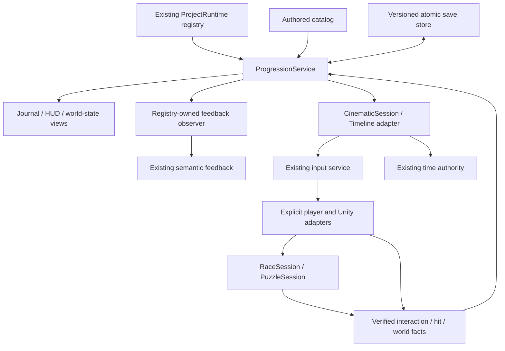

# Progression framework implementation

Latest continuation: fixture/journal usability corrections from `5761575b` are documented in ProgressionFixtureUsability.md. They preserve the existing quest/service architecture and accepted playground; use that numbered in-Unity guide for current acceptance. Earlier implementation records below remain historical evidence.

Baseline: aa9e9d58, verified clean on 2026-11-13. Feature branch: feature/progression-framework. Character Tuning hardening is retained, not repeated. Existing production input preferences are the only installed persistence; progression uses a separate versioned save owned by the existing ProjectRuntime service registry.

## Implementation stages

1. Definitions, validation, deterministic quests/relationships/objectives, atomic state and persistence. Test transitions, duplicates, prerequisites, rank/reward transactions, recovery and unknown IDs.
2. Independent race/puzzle/challenge sessions and explicit world adapters, interaction input, safe cinematic control leases. Test real triggers, interruption and lifecycle.
3. Progression Studio, journal/tracking/guidance, isolated fixtures and authoring instructions.
4. Integrated regression, serialized contracts, Windows build/startup and performance evidence. Record manual acceptance separately.

No story content or dagger mechanics will be authored. Existing playground assets and gameplay tuning remain unchanged. New composition is opt-in and explicit. Runtime state never writes authored definitions. Temporary attempts reset on reload; durable chapter rewards and pending cinematics survive. Reward entitlements are committed with progression; future external reward consumers must acknowledge a stable claim ID idempotently.

## Current status

Framework implementation stages are integrated as an opt-in candidate. The original playground remains unchanged; the isolated fixture exercises real production movement/input, progression, world sessions, Timeline and saving. Final evidence and completion boundaries are in ProgressionReleaseCandidate.md and ProgressionValidation.md. Manual authored-content acceptance and target-player budgets remain separate gates.

Stage 1 checkpoint: 3ffce279. Stage 2 adds race checkpoints/branches, puzzle ordering/destinations/reset/partial persistence, explicit actor/world adapters, lethal Sling and Air Cast bindings, input blocking leases and cinematic orchestration. Race/puzzle clocks use scaled gameplay delta, so pause/hit-stop slow or freeze both player and attempt. No independent wall-clock penalties are inferred. New bindings live in the existing input service's cloned asset with fixed IDs; existing assets are untouched.

Stage 2 checkpoint: 769a1b00. Stage 3 checkpoint: f45cdb8b, Progression Studio/journal/HUD, isolated authored fixture, persistent service input handoff and registry-owned semantic notifications. Stage 4 adds complete objective filtering, scene binding/reference validation, actual motor-driven rendered race and Cast projectile integration, persistent collection presentation, save-failure control restoration, timings and Windows verification. See the checkpoint containing ProgressionReleaseCandidate.md for final source/evidence.

## Dependency boundaries

No new movement, camera-follow, animation graph, resource, input polling singleton or time-scale writer is introduced. The cinematic adapter temporarily toggles its explicitly bound cameras while the existing time/input authorities hold gameplay; portable player pose ownership is retained. New scene/profile composition is deliberate authoring, not an automatic migration of the accepted playground.

## Ownership contracts

- ProjectRuntime.Services owns ProgressionService. ProgressionHost explicitly receives ProjectRoot/catalog and resolves an existing registered service on reload. It does not create another singleton or save authority.
- Definitions are snapshotted at service construction; play-time authoring edits require restart. Snapshot returns copies. Progression state never changes ScriptableObjects.
- Race and puzzle definitions are also copied when sessions are constructed. Extension evaluators must be pure matchers; return facts from authoritative gameplay adapters, not input press counts or repeated hierarchy scans.
- Accepted quests observe verified occurrences. Per-quest receipts prevent one duplicate callback completing a newly unlocked sequential stage. Unique-target objectives additionally deduplicate stable object IDs. Independent quests may consume the same event.
- Rank-up commits quest, rank, chapter, entitlement claims and pending cinematic together. Presentation exceptions cannot roll back committed state. External reward systems must consume stable claim IDs idempotently; no dagger/equipment mechanics exist.
- RaceHost/PuzzleHost adapt regular C# sessions. Actors and checkpoints are explicitly wired. Triggers require a collider belonging to the bound actor. Interaction validates range/channel/prerequisite state; high-level challenge/enemy facts cannot be forged through its generic fact command.
- ProgressionFactView reconstructs collection/discovery presentation from persistent facts; ProgressionUnlockView drives gates/routes from durable entitlements. Their observers remain outside objects they hide. No duplicate world-state database exists.
- AirflowProgressionAdapter listens to real Cast hits, using explicit node-to-mechanism mappings. EnemyProgressionAdapter observes the explicitly bound player's lethal Sling impact and assigns one occurrence per enemy lifetime. Other future damage sources must provide their own authoritative actor/occurrence adapter.
- Cinematics require idle grounded safety, explicit gameplay/cinematic cameras and director. They acquire existing time-authority pause and centralized input leases. Portable player animation retains ownership; Timeline bindings to the player hierarchy are rejected. NPC/cinematic camera tracks are supported. Missing content remains pending until a deliberately selected, allowed skip fallback. Replays grant nothing. Disable/interruption releases control and leaves unresolved playback pending.

## Persistence contract

Schema 1 uses stable string identities and JSON under Application.persistentDataPath/<saveSlot>.json. v0 records migrate to v1; unknown future schemas or malformed saves fail closed without overwriting. Same-volume temporary write/flush/replace retains a .bak; recovery never silently resets a corrupt save. Unknown definition records remain in the save for restored/DLC content. Definition renames require explicit content migration; IDs should be permanent. Active known quests gain new objective records and lose stale ready status when content changes.

Unresolved Playing cinematics reconstruct as Pending. Race attempts and temporary puzzle mechanics reset; authored persistent partial puzzle state and permanent solved state reconstruct. Solving a permanent puzzle commits world completion and its rewards in one transaction. Occurrence receipts and successful race attempt IDs currently accumulate; long-lived save-size profiling is required before shipping large/repeat-heavy content. Atomic replacement protects normal interrupted writes, not every storage/hardware failure; inspect the backup rather than overwrite an unsupported save.

A cinematic completion write failure releases input/time/camera control and reports the storage error. Its uncommitted watched/skipped state is not fabricated; restoring storage and reconstructing the service reoffers the persisted unresolved cinematic. Replays preserve the original resolution record and grant nothing. Scene reload does not replay historical journal completion notifications.

Read ProgressionAuthoring.md for numbered setup and manual tests, ProgressionPerformance.md for measured command timings and scaling limitations, and ProgressionValidation.md/TestResults.json for actual runs, including failed iterations.
