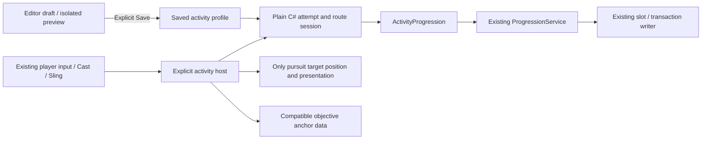

# Wind Relay & Dynamic Pursuit implementation report

## Isolation and installed baseline

Isolated branch `codex/quest-relay-pursuit`, worktree `D:/Fork/Windrunner/Logs/QuestRelayPursuitWorktree`, based on clean world-building `5db46de2`. Production progression, movement, Dagger/Second Wind, portable animation, Terrain Studio, Prototype Transfer, Environment Authoring Studio and approved forest packages are present. Separate performance/cinematic UI branches were not merged. No desktop control, push or merge.

## Implementation inventory

- `Progression/Runtime/Activities`: plain C# relay graph/session, immutable sampled route, pursuit motion/capture/near-miss session and adapter into existing durable progression commands; ScriptableObject authoring profiles. No save schema change.
- `WindrunnerActivities/Runtime`: explicit player-bound relay/pursuit adapters, actual Cast/Sling subscriptions, existing Interact adapter, state presentation hooks, main-AirPower bonus through existing Restore, reusable start/retry interaction and development-only instructions.
- `WindrunnerActivities/Editor`: Relay & Pursuit Studio with isolated drafts, explicit Save, Undo, profile validation, scene object creation, route/tangent handles, graph/range gizmos, safe static-mesh preview, demo builder and explicit-scene Windows candidate builder. No scene build-list mutation.
- `WindrunnerActivities/Demonstration`: independent copied production-player scene, new catalog/profiles, three relay nodes and Ground/Air/Hybrid lanes. No production Zone 01 placement or terrain edits. Actual production AirNode prefab is reused for relays.
- Added deterministic rule/persistence tests, real Cast/Sling integration tests, preview/save identity tests, and a production-player demo scene/pause/ground/quest/capture-evidence test.

Player movement, camera, animation ownership, ability values, resource rules and original save services are unchanged. Road splines remain terrain-authoring infrastructure; pursuit uses its own small local route cache and never edits roads. Host target scale must be one; dynamic Rigidbody and Animator root-motion competition is rejected.

## Semantics and persistence

Relay supports sequential/unordered/DAG graphs, any/all incoming branches, optional completion contribution, delay/window/warning/overall timers, per-node player-state eligibility, global or per-node expiry reset, retry limits and same-session partial retention. Expiry wins before same-frame activation. Duplicate delivery tickets and already-activated states cannot progress twice. Cast/Sling use their actual bound callbacks; Interact uses the installed production input controller.

Pursuit supports ground/air/hybrid outgoing segments, cached cubic/linear arc-length paths, stop/loop/ping-pong endpoints, start distance/direction, acceleration/deceleration, independent orientation rate, bounded speed response, waypoint pauses/events/eligibility, escape limits and retry. Near misses require approach and subsequent retreat with swept closest approach, hysteresis, delay, chance/cooldown/count limits. Capture takes precedence. Reverse reactions anticipate/decelerate; optional bursts obey speed bounds. A large player discontinuity suppresses capture/miss for that update. Ground probes ignore player/target colliders and fail closed on missing/saturated geometry.

Completion uses the existing synchronous `CompleteChallenge` ledger; no duplicate first-clear rewards or new relationship authority. Per-node/checkpoint `Interaction` facts are separate durable commands. If node credit succeeds but whole completion fails, the node fact remains durable; a retry cannot duplicate that occurrence. Write failures do not advance local captured/activated state. Optional extra relay AirPower restores only the main meter; it does not invent a new eligible Second Wind reward source. Existing Cast/Sling rewards remain unchanged.

**Save policy:** completed quest/objective/challenge records persist in the current schema. Mid-attempt motion, timers, near-miss state, retry count and partial relay progress restart after load/scene recreation. Replayability and first-clear rewards use existing ChallengeDefinition settings. Story quests retain their existing acceptance and explicit chapter turn-in rules. Required-active-quest gating cancels local attempts rather than failing a relationship chapter.

This branch lacks the latest cinematic Wayfinder. Relay exposes all available anchors (including branches); pursuit exposes its active moving target and clears it on terminal state. No crosshair or unrelated UI implementation is added.

## Validation history

- Rules first run: 11/12; one assertion expected Available at the exact warning threshold, where Expiring is correct. Assertion corrected; no failed result counted as passing.
- Rules/persistence follow-up: **15/15** passing, including injected failed write, retry, idempotent first-clear rewards, reload and independent saves.
- Real ability integration: **4/4** passing. Real production Cast input/projectile/reward ordering and Sling input/traverse/impact/launch ordering pass through both adapters. Pursuit capture waits to hide a Sling target until the production traversal releases it.
- Full initial Edit Mode: **172/172** passing; full initial Play Mode: **61/61** passing.
- Authoring safety expansion initially passed 172/173: test expected a pre-CreateAsset name, but Unity names the asset from its file. Test now compares the actual saved identity. It verifies draft nonmutation, preview cleanup, explicit Save identity/GUID preservation and Undo.
- Initial demo builder saved new assets then failed to restore an empty batch-mode setup; guarded cleanup corrected. Follow-up generated-profile/catalog validation passed. Original source scene was not saved.
- Initial demo movement assertion sampled fewer than the configured two-second start delay; replaced with a bounded movement wait. Rendered inspection then rejected scenery-obscured views; only the disposable lane was moved above copied template scenery and Interact start pedestals were added.
- Initial full Play run after adding the build helper stopped before tests on its report field type mismatch (int/uint). Corrected. It is not a test pass.

Final review identified pre-projection ground distance and discontinuous Hybrid endpoints; a regression test and projected arc-length/shared-endpoint correction were added. The first Windows build is preliminary and will not be reported as the corrected candidate. Review also corrected No Evasion to acknowledge a miss without braking, normalized the pursuit initial player position into route-local coordinates, and completed demonstration Interact setup without changing production input or actor-distance limits.

Final suites, serialized audit and Windows build results are recorded in the evidence summary. No unexecuted result is claimed here. The static GUID audit resolved 165 per-file asset references against 24,134 project/package meta files, with zero missing GUIDs and zero duplicate GUIDs among the added assets. Its first invocation used the wrong Windows text decoding for a Cyrillic vendor filename; the UTF-8 rerun completed successfully.

## Limits and remaining manual acceptance

See RelayPursuitAuthoring.md for step-by-step creation and testing. No final creature animation, VFX or audio asset is invented. Static preview intentionally excludes gameplay scripts and terrain raycasts; skinned-only prefabs use a sphere. In-engine ground, shape and animation acceptance remains necessary. This is authored-route motion, not obstacle-avoiding AI or NavMesh navigation.

Route speed is measured along the baked path after ground projection. Ground/air joins share grounded endpoints where a segment touches ground; interior airborne points retain authored height. Ground geometry is sampled on attempt creation, not rebuilt every frame. Keep ground-route roots static during an attempt; restart after terrain or route-root changes. Curve resolution is 64 samples per curved segment. Coincident spans are skipped; do not author required checkpoint events on zero-length spans. Extreme settings that exceed 1,024 waypoint crossings in a substep are rejected rather than hanging. Near-miss chance is seeded for reproducible input sequences, not a network simulation contract. Explicit activity configuration is captured at attempt start; author bindings while stopped/disabled.

No mouse-driven authoring test, manual chase fairness judgment or final artistic approval was performed. Captured demonstration images show actual rendered composition/state; rule-driven relay progression in the demo test is distinguished from the separate real Cast/Sling integration tests. Long-route rule coverage runs 36,000 ticks, but no zero-allocation or target-hardware performance claim is made without measured evidence. Existing full suites retain movement, water, save, menu and lifecycle coverage.

## Build warning review

The cold preliminary Windows Development build succeeded with zero errors and 39 warnings. These originate in unchanged baseline content, not the new activity code:

| Count | Origin | Meaning / disposition |
|---:|---|---|
| 2 | Existing Shadow_Dagger and 41 environment collider meshes | Unity currently enables required mesh Read/Write or collision baking; importer work is deferred to its owning asset task. |
| 14 | FEEL MMTools/MMFeedbacks | Reflection/unloaded-assembly and BinaryFormatter compatibility warnings in vendor code. This feature uses the existing progression writer, not those vendor save classes. |
| 3 | Existing AirChimeTrial, PlayerWindFeedback, AutumnPostProcessController | Deprecated FindFirstObjectByType calls. No unrelated refactor included. |
| 2 | Unity debug occlusion shaders | Pipeline-tag stripping for debug shaders. |
| 3 | Optional FEEL Cinemachine/PostProcessing Resources | Missing optional integration scripts in vendor templates; not new demo host bindings. |
| 4 | Existing INab progress-bar / Toony Colors shader | Numeric/derivative shader warnings on DX11 and DX12. |
| 11 | Raygeas URP shaders | Deprecated Forward+ / GBuffer includes. Vendor assets retained unchanged. |

The final warm build's own warning count is recorded separately; cache differences are not treated as warning fixes.

## Focused completed-quest lifecycle correction

A new disposable Play Mode fixture reproduced a real startup edge case: with `requiredActiveQuest` already completed, `Begin` returned before the activity's terminal-visibility restoration, leaving the captured target visible in a recreated scene. The before-fix test failed 0/1 on that exact assertion. PursuitHost now restores completed-quest visibility at Start independently of starting an attempt. It does not change progression, replay rewards, player movement or authored world assets. The full-suite labels use `relay-pursuit-release`, and the final Windows candidate uses `relay-pursuit-verified`; earlier candidate builds remain preserved as intermediate evidence.

## Final executed results — 2026-11-19

| Gate | Actual result |
|---|---|
| Matching Unity compilation + full functional Edit Mode | **175/175 passed**, including final Editor-only route arrows/sequential connection correction (`relay-pursuit-authoring-final`). |
| Full functional Play Mode | **65/65 passed** (`relay-pursuit-release`). |
| Completed-quest scene-recreation regression | Before fix **0/1**, after fix **1/1**; included in the full 65. |
| Windows Development build | **Succeeded**, **0 errors**, **24 warnings**, **30.577 s**, 1,419,307,593 bytes (`Builds/relay-pursuit-verified/Windrunner.exe`). |
| Graphics-enabled Windows startup | Survived **15 s**, initialized successfully, **0 reported errors**. Process CPU 10.125 s; peak working set 1,075,167,232 bytes. These are startup/process observations, not steady-state frame or allocation measurements. |
| Serialized contracts | **67 checked**, **0 failures**. |
| New asset GUID/dependency audit | **165 references resolved**, **0 missing GUIDs**, **0 duplicate new GUIDs**, **0 missing meta files**. |
| Baseline preservation | All existing Assets/ProjectSettings restored to the branch baseline after verified Unity-generated import/test changes. Original world-building checkout remains clean at `5db46de2`. |

The final Windows build contains all final source, including corrected routes, completed-quest startup, authoring gizmos and UTF-8 demo instructions. Full Edit Mode ran after the gizmo corrections. After the full 65 Play Mode tests, only demo instruction text encoding changed; the four demo tests reran and passed before the final rebuild. No authored data or gameplay behavior changed in that last correction. Functional suites use the repository wrapper's `!Profiling` filter. Cold build warnings (39) and warm build warnings (24) differ because shader warnings were not re-emitted from cache; no warning fix is claimed. All raw logs/builds remain under this worktree's ignored Logs/Builds folders. **RelayPursuitEvidence.json** records exact XML hashes, build warnings, screenshots, source manifest and startup scope.

Rendered camera evidence in `Logs/RelayPursuit`: `relay-available`, `relay-expired`, `relay-retry`, `relay-complete`, `Ground`, `Air`, `Hybrid`, `production-near-miss-reversal`, `production-capture`, `hybrid-air-peak`, `hybrid-ground-return` (PNG). The near-miss/capture scenario drives the actual production motor with virtual Gamepad input; it is not a teleported interception. The Hybrid scenario traverses ascent and landing and asserts bounded vertical displacement. The relay demonstration's explicit rule-driver expiry/progression images are separate from the real Cast/Sling integration cases. Camera renders exclude IMGUI overlays. Manual acceptance remains open; no claim of final artistic quality, chase fairness, zero allocations or target-hardware performance is made.
